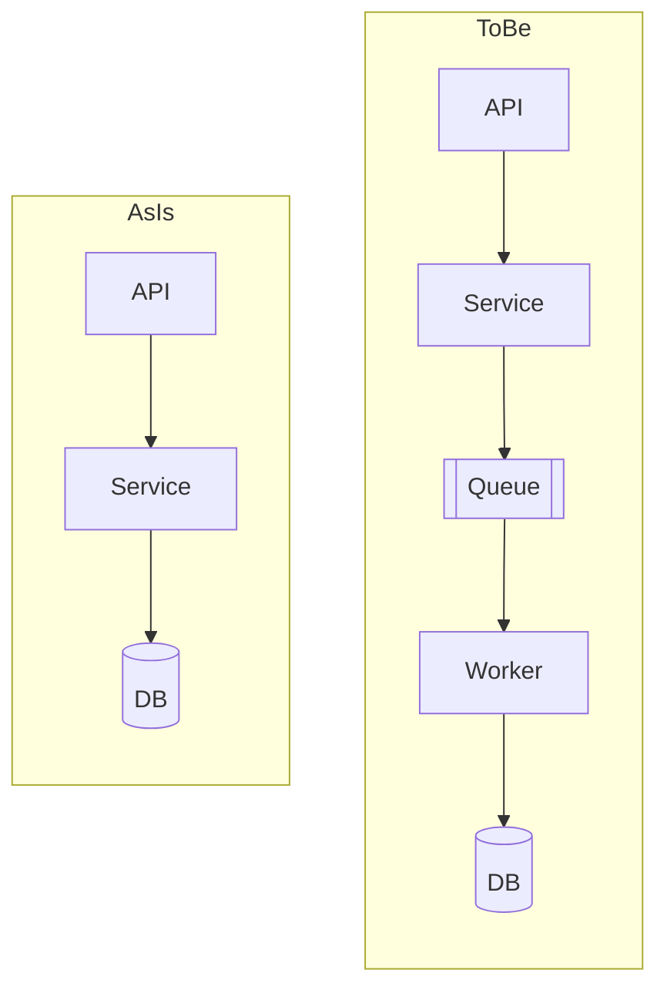

# Mermaid 図の規約

PR・ADR など、レビューや判断のために読む文書に Mermaid 図を添えるときの決まり。図は本文の説明を補うもので、本文を図だけに置き換えない。

## 図を入れる場面

処理の流れ、呼び出し順、状態、データ構造、責務の境界のどれかが変わるなら、図を 1 つ以上入れる。文章だけだと読み手が頭の中で組み立て直す必要があるためである。typo の修正や文言の変更など、構造が変わらないものには入れない。

- 図の直前に、その図で何を見てほしいかを 1 文で書く
- 1 つの図のノードは 15 個程度までにする。超えるなら観点ごとに図を分ける
- 変更の前後を比べる図は、下の「AsIs-ToBe 比較」に従う

## 図の種類

フローチャートに寄せず、示したいものに合わせて選ぶ。

| 示したいもの                               | 図の種類                                             |
| ------------------------------------------ | ---------------------------------------------------- |
| 処理の分岐・手順                           | `flowchart`                                          |
| サービス・モジュール間の呼び出し順、非同期 | `sequenceDiagram`                                    |
| ステータスと遷移の条件                     | `stateDiagram-v2`                                    |
| テーブルとリレーション                     | `erDiagram`                                          |
| 型・クラスの継承や依存                     | `classDiagram`                                       |
| システム構成、レイヤーと責務の境界         | `flowchart` + `subgraph`（境界を `subgraph` で囲む） |
| 段階的な移行・リリースの日程               | `gantt`                                              |

GitHub と Notion で描画できない種類（`architecture-beta`、`block-beta` など新しい実験的な図）は使わない。

## AsIs-ToBe 比較

変更前後は 2 つの図に分けず、1 つの図の中で左に AsIs、右に ToBe を並べる。`flowchart LR` の中に `subgraph` を 2 つ置き、見えないリンク `~~~` で横に並べる。

- ノード ID は `as_` / `tb_` の接頭辞で分ける。同じ ID を両側で使うと 1 つのノードにまとめられる
- `subgraph` をまたぐ矢印を引かない。またぐと `direction TB` が無視され、左右の並びが崩れる
- 高さの違う左右は縦中央に揃う。上端を揃えるためだけに見えないノードを足さない
- 変わった箇所は ToBe 側に `classDef changed stroke-width:3px` を定義して `class tb_queue,tb_worker changed` のように示す。色だけで区別しない（ダークモードとモノクロ印刷で読めなくなる）
- `sequenceDiagram` や `erDiagram` など `subgraph` を持たない図は、1 つの図で左右に並べられない。比較が必要なら変化した部分を `flowchart` の AsIs-ToBe で示し、ToBe の詳細は本来の種類の図で別に描く

## 構文の注意

- ラベルに `()`・`[]`・`:`・`/` などの記号や日本語を含むときは `["..."]` のように引用符で囲む
- ノード ID に `end` を使わない（`subgraph` の終端と解釈される）
- ラベルの改行は ` ` を使う
- 図を含む本文をコードブロックで出力するときは、外側のフェンスをバッククォート 4 連にして、内側の mermaid フェンスと衝突させない
